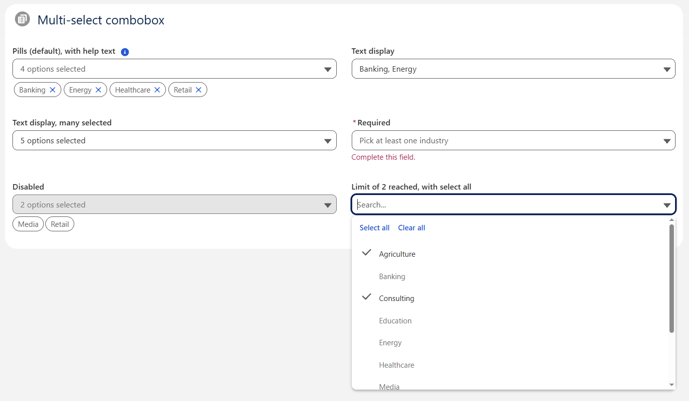

# LWC Multi-Select Combobox

A multi-select dropdown for Lightning Web Components that looks and behaves like `lightning-combobox`. It's built on the SLDS combobox blueprint with SLDS classes only (no custom CSS). It's meant to be used inside other LWCs and isn't exposed to App Builder or Flow.

| Component                           | Purpose                                                                                                                                                     |
| ----------------------------------- | ----------------------------------------------------------------------------------------------------------------------------------------------------------- |
| `c-multi-select-combobox`           | The combobox. Takes `options` as `{ label, value }[]`, and `value` is a `string[]`.                                                                         |
| `c-picklist-multi-select`           | Thin wrapper that loads a picklist field's values with `getObjectInfo` / `getPicklistValues` and uses the multi-select picklist format `'a;b'` for `value`. |
| `c-multi-select-combobox-selection` | Internal child that renders the selected pills. Not meant to be used directly.                                                                              |

## Demo



`c-multi-select-combobox-demo` shows each feature in its own tile: pills with help text, text display (labels and count), selection limit with select all, required with the error shown, and disabled. Add it to a Lightning tab or app page to try it.

## Usage

<!-- prettier-ignore -->
```html
<c-multi-select-combobox
  label="Industries"
  options={industryOptions}
  value={selectedIndustries}
  max-selections="3"
  required
  onchange={handleIndustriesChange}
></c-multi-select-combobox>
```

```js
industryOptions = [
    { label: 'Banking', value: 'Banking' },
    { label: 'Energy', value: 'Energy' }
];
selectedIndustries = [];

handleIndustriesChange(event) {
    this.selectedIndustries = event.detail.value; // ['Banking', ...]
    // event.detail.selectedOptions -> [{ label, value }, ...]
}
```

Bound to a picklist field:

<!-- prettier-ignore -->
```html
<c-picklist-multi-select
  label="Industry"
  object-api-name="Account"
  field-api-name="Industry"
  value={industryString}
  onchange={handleChange}
></c-picklist-multi-select>
```

`field-api-name` may also be qualified (`Account.Industry`), in which case `object-api-name` is optional. `record-type-id` defaults to the object's default record type. The wrapper's `change` detail is `{ value: 'a;b', values: string[], selectedOptions }`.

## API: `c-multi-select-combobox`

| Property                                                    | Default    | Description                                                                                                                         |
| ----------------------------------------------------------- | ---------- | ----------------------------------------------------------------------------------------------------------------------------------- |
| `label`                                                     |            | Field label. Required for accessibility, even with `label-hidden`.                                                                  |
| `options`                                                   | `[]`       | `{ label, value }[]`. The `value` identifies the option.                                                                            |
| `value`                                                     | `[]`       | Selected values, in the order they were selected. Values that match no option are kept, so the value can arrive before the options. |
| `selection-display`                                         | `pills`    | `pills`: removable pills below the input. `text`: the labels in the input (up to 3), then "N options selected".                     |
| `variant`                                                   | `standard` | `standard`, `label-hidden`, `label-inline`, `label-stacked`.                                                                        |
| `placeholder`                                               | none       | Text shown in the empty input.                                                                                                      |
| `field-level-help`                                          |            | Help text in a tooltip next to the label.                                                                                           |
| `disabled`                                                  | `false`    | No interaction; pills become read-only. A disabled field is always valid.                                                           |
| `required`                                                  | `false`    | At least one value must be selected.                                                                                                |
| `max-selections`                                            |            | Limit. Once it's reached, the unselected options are disabled.                                                                      |
| `show-select-all`                                           | `false`    | Adds "Select all" / "Clear all" buttons. They act on the options matching the current search.                                       |
| `message-when-value-missing`, `message-when-range-overflow` |            | Override the default error messages. `{0}` in the range message is replaced by the limit.                                           |
| `validity` (read-only)                                      |            | `{ valid, valueMissing, rangeOverflow, customError }`.                                                                              |

| Method                                                                | Description                                                                   |
| --------------------------------------------------------------------- | ----------------------------------------------------------------------------- |
| `clearSelection()`                                                    | Deselects everything and fires one `change` event (if anything was selected). |
| `checkValidity()` / `reportValidity()` / `setCustomValidity(message)` | Same behavior as the base components.                                         |
| `focus()` / `blur()`                                                  | Moves focus to or from the input.                                             |

The `change` event fires on every user change (one event per bulk action), with `detail: { value: string[], selectedOptions: {label, value}[] }`. It doesn't bubble and isn't composed. Setting `value` programmatically doesn't fire it.

### Keyboard

| Key                   | Closed                                | Open                                                                              |
| --------------------- | ------------------------------------- | --------------------------------------------------------------------------------- |
| ↓ / ↑ / Enter / Space | Opens and highlights the first option | ↓ / ↑ move the highlight (no wrap); Enter toggles the highlighted option          |
| Home / End            |                                       | First / last enabled option                                                       |
| Escape                | (not handled)                         | Closes (and doesn't let the event reach a surrounding modal)                      |
| Typing                |                                       | Filters options by label                                                          |
| Tab                   | Leaves                                | Moves to the Select all / Clear all buttons if shown, otherwise leaves and closes |

Opening with the mouse highlights nothing; clicking an option makes it the highlighted one, so the arrow keys continue from there.

### Known limitation

The dropdown can be clipped inside containers with `overflow: hidden` (e.g. some modals or datatable cells). SLDS-only styling can't fix this without moving the dropdown elsewhere in the DOM.

## Design

`multiSelectCombobox.js` only holds UI state and the public API. Every decision is made in a small pure module in the same bundle, each with its own unit tests:

| Module                 | Responsibility                                             |
| ---------------------- | ---------------------------------------------------------- |
| `selectionModel.js`    | Normalizing input; toggle / add / remove values; the limit |
| `optionFilter.js`      | Search filtering                                           |
| `keyboardNavigator.js` | Key → intent mapping; moving the active option             |
| `validation.js`        | Validity state and error message                           |
| `displayText.js`       | Text-mode summary                                          |
| `optionViewModel.js`   | Render model of the options (ids, ARIA state, classes)     |
| `styleClasses.js`      | SLDS classes per visual state                              |
| `formatLabel.js`       | `{0}` placeholders in the UI text                          |
| `uiText.js`            | All user-facing strings (English only)                     |

The input and the listbox share one template on purpose: `aria-activedescendant` / `aria-controls` can't reference IDs in another component's shadow root. See `docs/plan-multi-select-combobox.md` for the full design record.

## Development

```
npm install
npm test                    # Jest (unit + DOM + sa11y accessibility checks)
npm run lint
npm run prettier:verify
sf code-analyzer run --workspace . --target force-app
```

Deploy: `sf project deploy start --source-dir force-app`.
